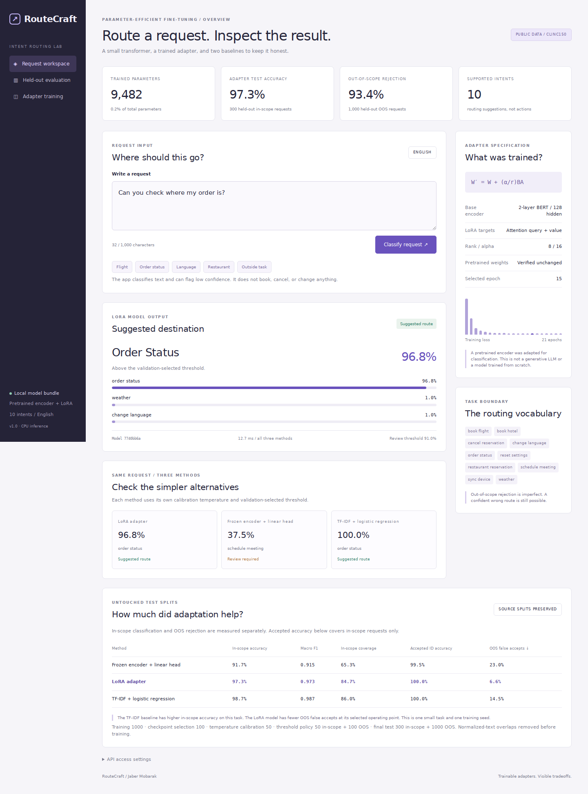

# RouteCraft

A small transformer that routes English requests to ten intents and sends uncertain requests for review. Built with a **real LoRA adapter**, two baselines, and a local dashboard.



## Run locally

Python 3.11 or 3.12. Clone the repository, then run from its root:

```bash
python -m venv .venv
# Linux / macOS
source .venv/bin/activate
# Windows: .venv\Scripts\activate
python -m pip install torch==2.8.0 --index-url https://download.pytorch.org/whl/cpu
python -m pip install -e '.[dev]'
python -m routecraft.cli verify
python -m routecraft.cli serve
```

Open **http://127.0.0.1:8030**. The pretrained weights and trained adapter are included; inference requires no API key or model download. Installation requires internet access. The dashboard and API use the same model bundle.

Or run `docker compose up --build`, then open the same URL. CPU only; no CUDA installation required.

## Measured results

A ten-intent subset of the public CLINC150 Full dataset. These are results from the committed bundle, seed 42, on 300 original in-scope test requests and 1,000 original out-of-scope test requests.

| Method | In-scope accuracy | Macro F1 | In-scope accepted | OOS false accepts |
|---|---:|---:|---:|---:|
| Frozen encoder + logistic head | 91.7% | 0.915 | 65.3% | 23.0% |
| LoRA encoder + trained head | 97.3% | 0.973 | 84.7% | 6.6% |
| TF-IDF + logistic regression | **98.7%** | **0.987** | 86.0% | 14.5% |

The lexical baseline wins in-scope accuracy. LoRA has fewer out-of-scope false accepts at its validation-selected threshold. The thresholds differ between models, so these are operating-point comparisons, not matched-coverage results. This is one small task and one seed; the table is not evidence of general superiority.

Only **9,482 parameters** are trained: 8,192 LoRA parameters and a 1,290-parameter classification head. That is **0.216%** of the resulting model. A hash check verifies that the pretrained base weights stay unchanged during training.

## What is inside

- A two-layer pretrained BERT encoder, with rank-8 LoRA on attention query/value projections using PyTorch and PEFT.
- Separate checkpoint-selection, temperature-calibration, review-policy and final-test splits. Test-label mutation is covered by a training regression test.
- Safe tensor model files, JSON baseline parameters, checksummed bundle verification and pinned source revisions.
- FastAPI batch inference, input validation, readiness checks, optional bearer authentication, and Prometheus-style process counters.
- A responsive dashboard comparing all three methods on each request.

This is **encoder classification**, not a generative LLM. It suggests routes; it does not book trips, cancel reservations or execute tools. It supports English, ten intents and a 48-token model limit. Out-of-scope detection is imperfect. See the [model card](docs/model-card.md) and [implementation notes](docs/architecture.md).

## API

```bash
curl http://127.0.0.1:8030/api/route \
  -H 'Content-Type: application/json' \
  -d '{"texts":["Can you check where my order is?","Explain quantum gravity."]}'
```

`POST /api/route` accepts 1–16 strings, each 2–1,000 characters. It returns the suggested intent, calibrated confidence, top three scores and a `route` or `review` decision for every method. Truncation is reported. Confidence is a score, not a correctness guarantee.

Interactive API docs: `/docs`. Health: `/health`. Model readiness: `/ready`. Metrics: `/metrics`. To require authentication, set `RC_API_TOKEN` and send `Authorization: Bearer <token>`. Health, readiness and the static page remain public. Requests are not persisted or sent to an external model. Process counters reset on restart.

## Reproduce and test

```bash
# Already included: selected dataset, pretrained base, trained bundle
python -m routecraft.cli train --epochs 24 --seed 42
python -m routecraft.cli verify
python -m pytest -q
python -m ruff check .
python -m ruff format --check .
```

`train` overwrites generated artifacts and the report; keep a copy if comparing runs. For fresh source acquisition, `python -m routecraft.cli prepare` downloads checksummed, pinned public sources and recreates `data/task.json`. Training is CPU-friendly; timings vary by machine. Results may differ slightly across dependency versions or hardware.

## Sources and licenses

Own application code: [MIT](LICENSE). Dataset excerpts: **CC BY 3.0**; see [data attribution](data/README.md) and the included [license](data/SOURCE_LICENSE). Pretrained model and its adapted weights: **Apache 2.0**, with the original [license](artifacts/base/LICENSE). Dependency and upstream author names appear only for attribution.

[Русское описание](README_RU.md)
